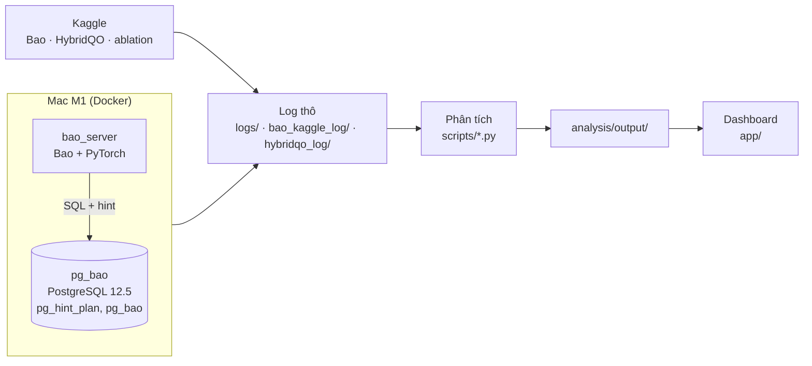

# Kiến trúc dự án `lqo-datamining`

Hệ thống phục vụ hai thí nghiệm của mục 4 báo cáo:
- **TN1:** kiểm chứng xem Bao và HybridQO có nhanh hơn PostgreSQL trên máy của nhóm không.
- **TN2:** thử một mô hình phân loại gọn nhẹ chọn phương án thực thi cho PostgreSQL.

## 1. Tổng quan



| Tầng | Thư mục | Vai trò |
|---|---|---|
| Hạ tầng | `infra/` | 2 container (`pg_bao` 10.5.0.5, `bao_server` 10.5.0.6), cấu hình PostgreSQL |
| Thực thi | `scripts/`, `kaggle/` | Nạp dữ liệu, làm nóng cache, train/test, đo các phương án, ablation |
| Dữ liệu | `logs/`, `bao_kaggle_log/`, `hybridqo_log/` | Log thô, không sửa, là đầu vào duy nhất của tầng phân tích |
| Phân tích | `scripts/*.py`, `analysis/output/` | Thống kê, khai phá dữ liệu, mô hình phân loại |
| Trình bày | `app/`, `scripts/demo_*` | Dashboard Streamlit, demo trực tiếp |

## 2. Hạ tầng

- Image PostgreSQL 12.5 build từ source cho ARM64, kèm `pg_hint_plan` và `pg_bao`. Hai container dùng chung mạng bridge với IP cố định.
- `scripts/` và `logs/` được mount vào cả hai container: log ghi thẳng ra máy host.
- Cấu hình `postgresql.lqo.conf`: `shared_buffers` 4 GB, `work_mem` 256 MB (bài báo dùng 32 GB / 4 GB), `geqo` bật, `autovacuum` tắt.
- Trên Kaggle dùng 8 GB / 512 MB, chung cho Bao và HybridQO.
- Vì bộ nhớ khác bài báo, nhóm chỉ so **xu hướng**, không so số tuyệt đối.

## 3. Pipeline

| Pipeline | Luồng chính | Đầu ra |
|---|---|---|
| Chuẩn bị | `load_imdb.sh` → `make_imdb50.sh` (cho ablation 8.3) → `warmup_imdb.sh` | `imdbload`, `imdbload50` |
| TN1 – Mac | `run_fair_comparison.sh` (PostgreSQL + Bao cùng phiên), `run_bao_split.sh` (train + test từng split) | `logs/test__*.txt`, `model__bao__*` |
| TN1 – Kaggle | `build_*_notebook.py` → `push_*_queue.sh` (tối đa 5 phiên) → tải log | `bao_kaggle_log/`, `hybridqo_log/` |
| Ablation | `ablation_interleaved.py` (8.4/8.5), `make_imdb50.sh` (8.3), `ablation_k_runs.py` (8.6) | `ablation_*.csv` |
| TN2 | `exp2_collect.sh`: 113 câu × 6 phương án × 3 lần, kèm EXPLAIN plan mặc định | `logs/exp2_*.jsonl` |

**Quy tắc đo:**
- Cache nóng; mỗi câu chạy 3 lần, lấy lần thứ 3.
- Timeout 180 s.
- Thắng/thua khi chênh lệch quá ±10% so với PostgreSQL.
- Ablation chạy xen kẽ các cấu hình theo từng câu.
- Script chạy dài có thể chạy tiếp từ chỗ dừng.

## 4. Phân tích

- **`lqo_common.py`:** đưa mọi loại log về một bảng chuẩn (thời gian lập plan, thực thi, suy luận, tổng, timeout).
- **TN1:**
  - `exp1_tables.py`: thắng/hòa/thua và speedup theo 9 split.
  - `c1_win_loss.py`: kiểm định Wilcoxon và sign test.
  - `ablation_analyze.py`: câu khác biệt khi |Δ| > 250 ms và Welch p < 0,05.
- **TN2 (`exp2_analyze.py`):**
  - Nhãn là phương án nhanh nhất; giữ `default` nếu chênh dưới 5%.
  - Đặc trưng chỉ lấy từ SQL và EXPLAIN, không dùng thông tin có sau khi chạy.
  - Mô hình: DT, RF, LightGBM, chia theo 9 split LOO/RND/BQ.
  - So với PostgreSQL, Bao và Oracle.

## 5. Trình bày

- **Dashboard:**
  - `prepare_data.py`: chạy 1 lần để tạo dữ liệu IMDB/JOB.
  - `core.py` và `group_results.py`: đọc kết quả đã tính sẵn.
  - `streamlit_app.py`: hiển thị 4 tab (Dữ liệu · Bài báo vs Nhóm · TN1 · TN2).
- **Demo:**
  - `demo_start.sh`: mở dashboard.
  - `demo_26a.sh`: chạy thật câu 26a với 3 phương án.
  - `record_demo.py`: quay video tự động theo kịch bản.

## 6. Quyết định thiết kế

| Quyết định | Lý do |
|---|---|
| Bao trên Mac, HybridQO trên Kaggle | Mac không đủ RAM cho HybridQO và không có GPU |
| Cache nóng, lấy lần chạy thứ 3 | Loại nhiễu I/O; ablation 8.6 cho thấy đến lần 3 thời gian đã ổn định |
| Notebook Kaggle sinh bằng code | Cấu hình 9 split giống hệt nhau |
| Log thô không sửa, kết quả tính lại được | Mọi con số đều truy về được log gốc |
| Dashboard chỉ đọc kết quả tính sẵn | Mở nhanh khi demo, không phụ thuộc container |

## 7. Chạy lại nhanh

```bash
docker compose -f infra/docker-compose.yml up -d
docker exec pg_bao bash /app/scripts/warmup_imdb.sh
caffeinate -dis bash scripts/run_fair_comparison.sh          # TN1
bash scripts/exp2_collect.sh && ~/.venvs/lqo-exp2/bin/python scripts/exp2_analyze.py   # TN2
python3 scripts/exp1_tables.py
bash scripts/demo_start.sh                                   # dashboard
```
